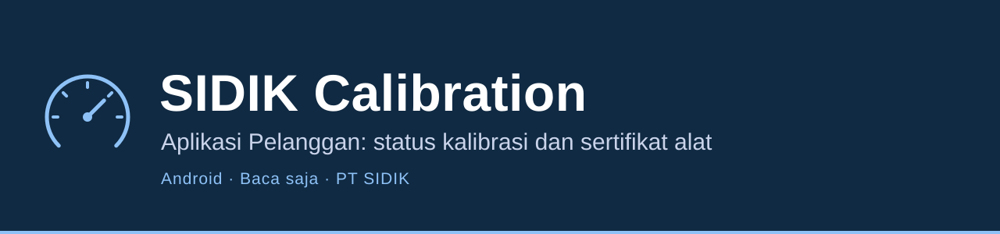
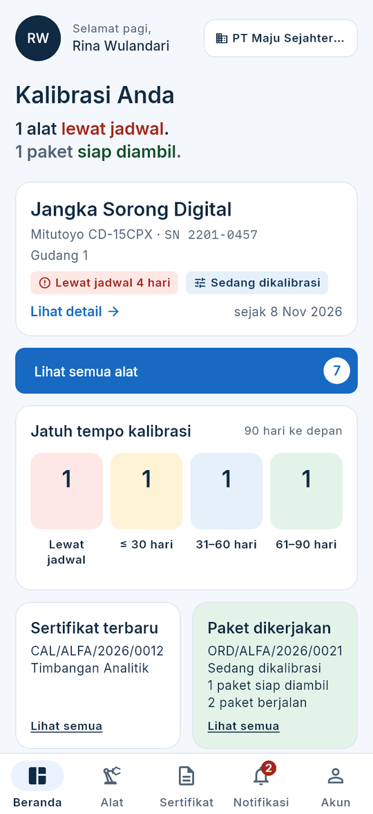
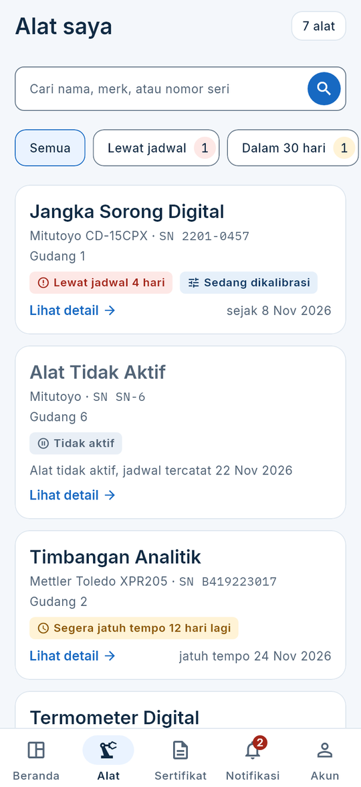
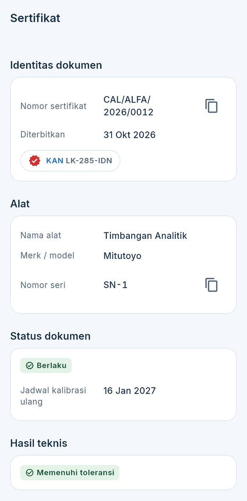
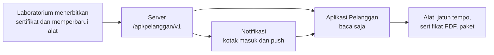
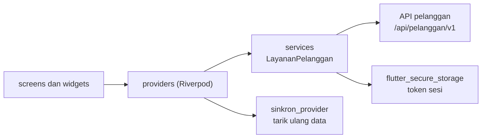

<p align="center">
  
</p>

<p align="center">
  <a href="https://github.com/ZainulArkaanAlinsi/sidik-pelanggan-mobile/actions/workflows/periksa.yml"></a>
  <a href="https://github.com/ZainulArkaanAlinsi/sidik-pelanggan-mobile/releases/latest"></a>
  
  
  
  
  
</p>

> **English.** SIDIK Calibration Customer is an Android app for companies that own instruments calibrated by the PT SIDIK laboratory. It shows calibration due dates, certificates (PDF and a public verification link), packages being worked on and notifications. Business data is read-only: accounts are created by invitation and the server remains the single source of truth. A support system for a KAN-accredited laboratory (LK-285-IDN); under active development.

**Isi:** [Ringkasan](#ringkasan) · [Peran dan fitur](#peran-dan-fitur) · [Cara kerja](#cara-kerja) · [Arsitektur](#arsitektur) · [Prinsip](#prinsip) · [Teknologi](#teknologi) · [Menjalankan secara lokal](#menjalankan-secara-lokal) · [Pengujian](#pengujian) · [Rilis dan pembaruan](#rilis-dan-pembaruan) · [Dokumentasi](#dokumentasi) · [Status dan peta jalan](#status-dan-peta-jalan) · [Kontribusi dan kepemilikan](#kontribusi-dan-kepemilikan)

## Ringkasan

Aplikasi untuk perusahaan pemilik alat ukur yang dikalibrasi di laboratorium PT SIDIK. Status kalibrasi, jatuh tempo, sertifikat, dan paket yang sedang dikerjakan tersedia dalam satu aplikasi, tidak lagi tersebar di kertas dan berkas PDF. Datanya dibaca dari API [`sidik-calibration-api`](https://github.com/ZainulArkaanAlinsi/sidik-calibration-api) (prefix `/api/pelanggan/v1`); apa yang terbit di laboratorium muncul di sini tanpa input ulang.

Sistem pendukung laboratorium terakreditasi KAN LK-285-IDN.

<table>
  <tr>
    <td align="center" width="33%"></td>
    <td align="center" width="33%"></td>
    <td align="center" width="33%"></td>
  </tr>
  <tr>
    <td align="center"><sub>Beranda</sub></td>
    <td align="center"><sub>Alat saya</sub></td>
    <td align="center"><sub>Detail sertifikat</sub></td>
  </tr>
</table>
<p align="center"><sub>Tampilan terbitan 0.3.1, tema terang. Data pada gambar adalah data contoh sintetis.</sub></p>

## Peran dan fitur

| Peran | Di aplikasi ini |
| --- | --- |
| Anggota perusahaan | Melihat alat, sertifikat, paket, notifikasi, dan daftar anggota; mengelola akunnya sendiri. Akun lahir dari undangan. |
| PIC utama perusahaan | Sama dengan anggota, ditambah menonaktifkan anggota. |
| Staf laboratorium (Master Data, Super Admin, Teknisi, Viewer) | Tidak memakai aplikasi ini. Bekerja di [aplikasi Lab](https://github.com/ZainulArkaanAlinsi/sidik-calibration-mobile); undangan akun pelanggan berasal dari admin lab atau PIC utama. |

| Area | Isi |
| --- | --- |
| Beranda | Ringkasan jatuh tempo (lewat jadwal, sampai 30 hari, 31 sampai 60 hari, 61 sampai 90 hari), alat yang mendesak, sertifikat terbaru, paket dikerjakan. |
| Alat saya | Daftar dengan pencarian nama, merk, atau nomor seri; saringan jatuh tempo; detail dan riwayat kalibrasi; tombol minta kalibrasi ulang. |
| Sertifikat | Daftar dan arsip (tahun, bulan, pekan, hari), pencarian, detail, pratinjau dan unduh PDF, tautan verifikasi publik. |
| Paket | Daftar dan tahap pengerjaan paket di laboratorium. |
| Notifikasi | Kotak masuk di aplikasi; push bersifat opsional. |
| Akun | Ganti sandi, preferensi notifikasi, anggota, pilihan perusahaan, hubungi PT SIDIK. |

Aplikasi hanya menampilkan data bisnis. Operasi tulis dibatasi daftar izin yang dijaga test (`test/guard_tulis_test.dart`): masuk dan pemulihan sandi, ganti sandi, preferensi dan tanda baca notifikasi, token perangkat push, dan penonaktifan anggota oleh PIC utama.

## Cara kerja



Server satu-satunya sumber data: status jatuh tempo, tahap paket, dan kepemilikan dihitung server, sehingga data sama di HP mana pun akun ini masuk. Aplikasi menarik ulang data saat kembali ke layar depan dan saat push masuk.

## Arsitektur



| Lapisan | Tempat |
| --- | --- |
| Konfigurasi, tema, gerak | `lib/core/` (tema: [`README`](lib/core/tema/README.md)) |
| Model data | `lib/models/` |
| Layanan API, push, pembaruan | `lib/services/` |
| State (Riverpod) | `lib/providers/` |
| Layar | `lib/screens/` (beranda, alat, sertifikat, paket, notifikasi, akun, auth) |
| Komponen | `lib/widgets/` ([`README`](lib/widgets/README.md)) |

## Prinsip

- **Baca saja untuk data bisnis.** Tulis hanya yang ada di daftar izin; selebihnya ditolak test.
- **Tidak ada logika bisnis di HP.** Status dan kepemilikan dari server. Dua pengecualian tertulis, sampai server mengirimnya: kelompok alat 31 sampai 90 hari dan status masa berlaku sertifikat di riwayat alat ([`docs/kebutuhan-api-pelanggan.md`](docs/kebutuhan-api-pelanggan.md)).
- **Perusahaan dipilih lewat header, bukan isi permintaan.** Aplikasi tidak pernah mengirim `customer_id`; server memeriksa keanggotaan.
- **Token di penyimpanan terenkripsi** (`flutter_secure_storage`), bukan `SharedPreferences`.
- **Istilah status.** "Lewat jadwal" dan "Masa berlaku berakhir", bukan "kedaluwarsa", sampai istilah resmi ditetapkan; semua kata status ada di `StatusBerlaku.label`.
- **Tema sendiri, bukan salinan aplikasi Lab.** Token di `lib/core/tema/`; layar tidak menulis warna atau jarak sendiri dan gerbang desain di `test/tema/` menolaknya ([`docs/standar-kualitas-desain.md`](docs/standar-kualitas-desain.md)).

## Teknologi

| Lapisan | Teknologi |
| --- | --- |
| Framework | Flutter 3.44.6 (dipatok di CI), Dart `^3.11.5` |
| State | Riverpod 3 (`flutter_riverpod ^3.3.2`) |
| Jaringan dan sesi | `http`, `flutter_secure_storage` |
| PDF | `pdfx` |
| Push dan galat | `firebase_messaging`, `firebase_crashlytics` (opsional, butuh berkas konfigurasi) |
| Navigasi | Lima tab (Beranda, Alat, Sertifikat, Notifikasi, Akun): bar bawah di HP, rel samping pada lebar 600 dp atau lebih |
| Bahasa | Indonesia |

## Menjalankan secara lokal

```bash
git clone https://github.com/ZainulArkaanAlinsi/sidik-pelanggan-mobile.git
cd sidik-pelanggan-mobile
flutter pub get
flutter run --dart-define=API_BASE_URL=http://10.0.2.2:8000   # emulator Android ke API lokal
```

`10.0.2.2` adalah localhost laptop dilihat dari emulator Android; prefix `/api/pelanggan/v1` ditambahkan aplikasi. API lokal harus menyalakan modul pelanggan (`FITUR_PELANGGAN=true`); lihat [`sidik-calibration-api`](https://github.com/ZainulArkaanAlinsi/sidik-calibration-api#menjalankan-secara-lokal).

Push bersifat opsional; aplikasi berjalan penuh tanpanya dan kotak masuk tetap sumber kebenaran. Untuk menyalakannya, taruh `google-services.json` dari proyek Firebase yang sama dengan server di `android/app/`. Berkas itu tidak ikut repo.

## Pengujian

```bash
flutter analyze
flutter test
flutter test integration_test -d <id-perangkat>   # butuh perangkat
```

CI (`periksa.yml`) menjalankan analyze, test, dan build Android debug pada tiap push ke `main` dan tiap pull request, tanpa berkas kredensial. Skenario alur dasar juga berjalan tanpa perangkat di `test/alur_dasar_test.dart`. Tampilan diperiksa tanpa emulator: `SIDIK_PNG_DIR=<folder di luar repo> flutter test test/tampilan/render_layar_test.dart` me-render layar kunci pada beberapa ukuran HP dan tablet, terang dan gelap; tanpa variabel itu, test yang sama menjadi gerbang luapan dan sasaran sentuh.

## Rilis dan pembaruan

Aplikasi tidak ada di Play Store. APK dibagikan lewat [GitHub Releases](https://github.com/ZainulArkaanAlinsi/sidik-pelanggan-mobile/releases). Aplikasi terpasang membaca `versi-pelanggan.json` dari rilis terbaru, menampilkan banner pembaruan, mengunduh APK (otomatis hanya di Wi-Fi), mencocokkan SHA-256, lalu membuka pemasang Android.

<details>
<summary><b>Langkah merilis</b></summary>

1. Naikkan `version:` di `pubspec.yaml`; angka build setelah `+` wajib naik.
2. Siapkan kunci penandatangan rilis (tidak ikut repo). Skrip menolak APK bertanda tangan kunci debug.
3. Jalankan `tool/rilis.ps1 -Catatan "..."` (tambah `-Wajib` untuk pembaruan wajib). Skrip membangun APK, menulis manifes dengan SHA-256 dan ukuran, lalu membuat rilis GitHub.

Perubahan masuk lewat pull request ke `main` dengan CI hijau.

</details>

## Dokumentasi

| Dokumen | Isi |
| --- | --- |
| [`docs/kebutuhan-api-pelanggan.md`](docs/kebutuhan-api-pelanggan.md) | Kebutuhan API dan pengecualian logika di sisi HP |
| [`docs/standar-kualitas-desain.md`](docs/standar-kualitas-desain.md) | Standar kualitas desain dan gerbang otomatisnya |
| [`docs/pustaka-pdf.md`](docs/pustaka-pdf.md) | Pustaka PDF |
| [`lib/core/tema/README.md`](lib/core/tema/README.md) | Token tema |
| [`lib/widgets/README.md`](lib/widgets/README.md) | Komponen |
| [Kontrak API pelanggan](https://github.com/ZainulArkaanAlinsi/sidik-calibration-api/blob/main/docs/kontrak-api-pelanggan.md) | Kontrak endpoint (di repo API) |

## Status dan peta jalan

Dalam pengembangan aktif (per 18 Nov 2026).

| Status | Isi |
| --- | --- |
| Berjalan | Rilis Android publik lewat GitHub Releases dengan pembaruan di dalam aplikasi; semua layar pada tabel fitur di atas. |
| Belum terdokumentasi | Uji di perangkat sungguhan (HP ARM32 dengan RAM 2 GB: pembaruan dari versi lama, huruf sistem maksimum, laporan galat). CI dan uji widget tidak menggantikannya. |
| Belum | Teks hanya Bahasa Indonesia; pindah ke ARB/l10n bila pelanggan berbahasa lain mulai ada. |

## Kontribusi dan kepemilikan

Proyek ini dikembangkan untuk PT SIDIK dan dipelihara oleh Zainul Arkaan. Informasi laboratorium: <https://pt-sidik.com/calibration/>.

- Perubahan lewat pull request ke `main` dengan CI hijau; jangan push langsung.
- Commit memakai [Conventional Commits](https://www.conventionalcommits.org/). `flutter analyze` harus bersih.
- Repo ini publik: jangan menulis kredensial, token, kunci penandatangan, atau data pelanggan asli di berkas, tangkapan layar, maupun berkas contoh.
- Repo ini belum memuat berkas `LICENSE`; ketentuan penggunaan ulang belum ditetapkan.
